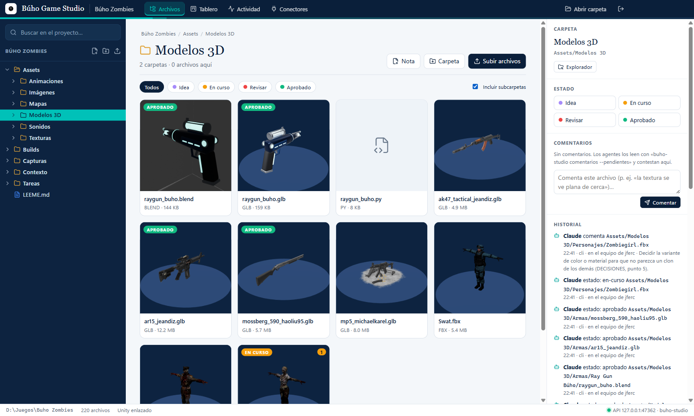
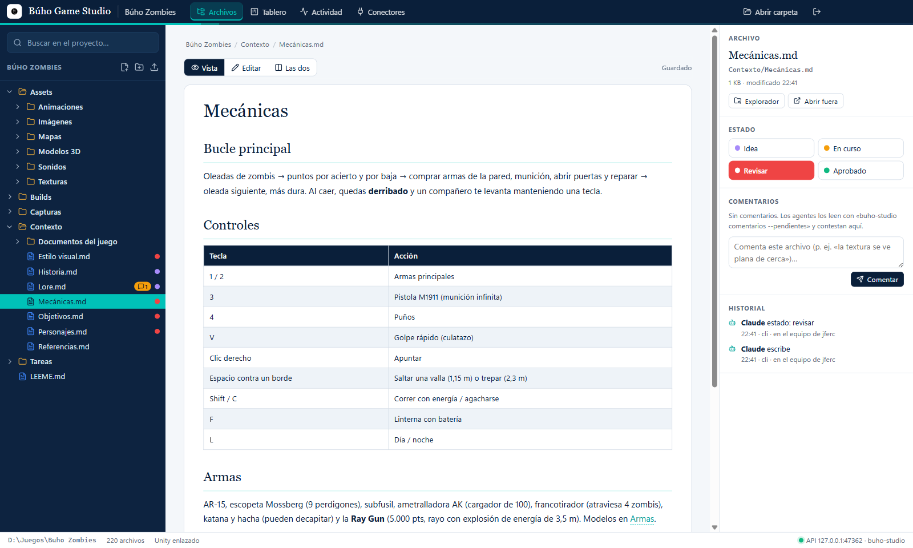
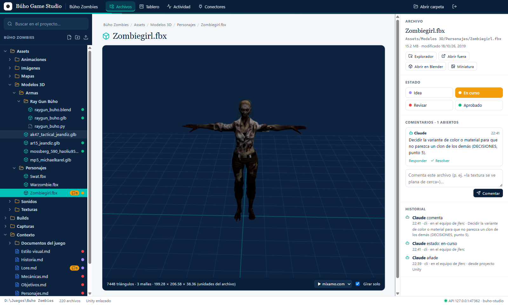
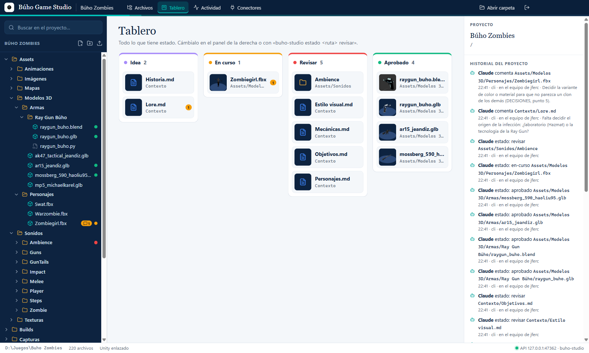
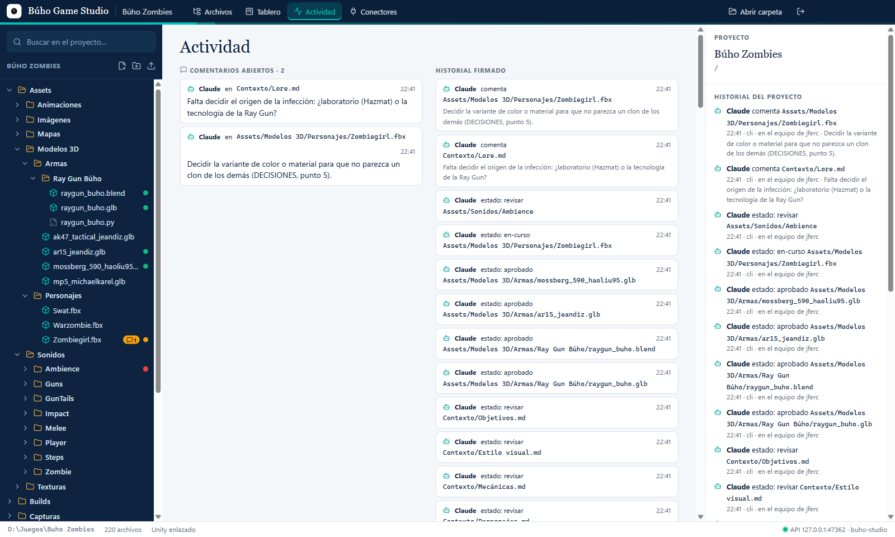
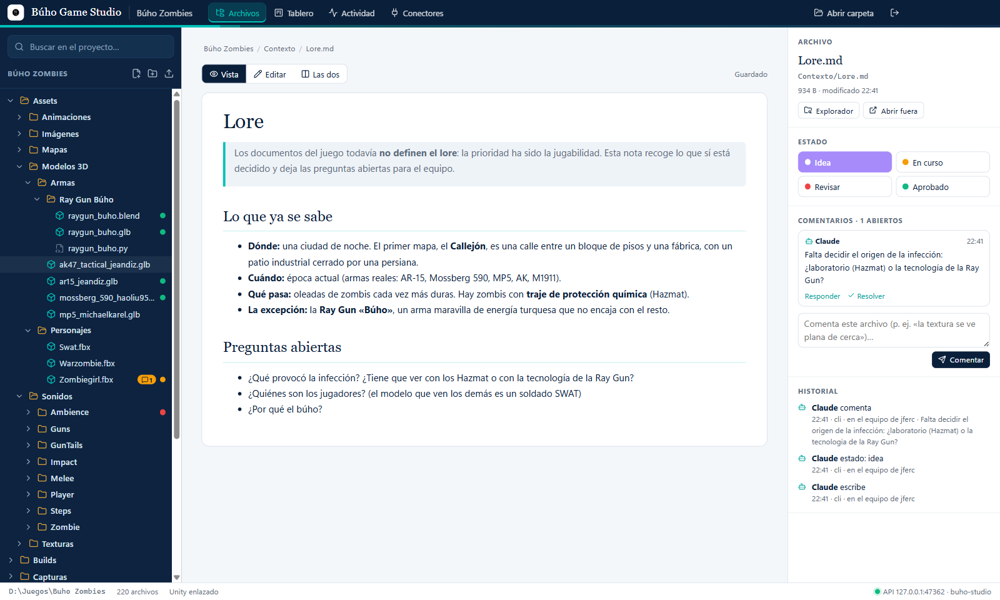
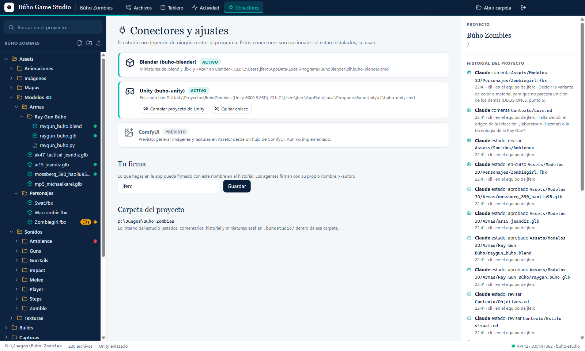

# Búho Game Studio

**La mesa de trabajo de tu videojuego**, para personas y agentes de IA. Hecho por [Búho AI](https://buhoai.es).

Cada proyecto es **una carpeta de verdad** (como en VS Code): el contexto del juego en Markdown, los assets con
miniaturas y visor 3D, estados de revisión, comentarios y un historial que firma cada cambio. Un agente (Claude Code,
Codex, Copilot, Gemini…) trabaja con el CLI `buho-studio` y lo que hace **aparece al momento en la app**.

No depende de ningún motor: Unity, Godot o Unreal se enlazan como conectores opcionales.



## Qué hace

| | |
|---|---|
| **IDs** | Todo (archivo, carpeta, tarea) tiene una ID estable (`a-…`, `c-…`, `t-…`) que no cambia al mover o renombrar. Clic derecho → **Copiar ID** y la pegas en el chat con la IA: «cambia `a-3f9c21b0`…». El CLI acepta IDs donde va una ruta. |
| **Tareas** | Kanban (por hacer, en curso, revisar, hecha) con prioridad, asignada (persona o agente), assets enlazados por ID y pasos marcables. Cada tarea es un `.md` en `Tareas/`; los agentes las crean y mueven con `buho-studio tarea`. |
| **Ayuda** | Ayuda dentro de la app (`docs/ayuda/`), la misma que leen los agentes con `buho-studio ayuda`. |
| **Inicio** | Portada del proyecto con sus cifras, lo pendiente (por revisar, en curso, comentarios) y una tarjeta por sección (Contexto, Assets, Capturas, Gameplay…) con miniaturas de lo que hay dentro. |
| **Estilos** | Seis preajustes de color desde el botón «Estilo» de la barra: Claude (por defecto), Búho, Búho noche, Búho AI tinta, Arcade y Blanco y negro. |
| **Gameplays** | Reproductor con saltos de ±10 s (J/L), velocidad de 0,5× a 4×, anterior/siguiente (AvPág/RePág o Alt+flechas), «al acabar, el siguiente» y tira con los demás vídeos de la carpeta. |
| **Proyectos = carpetas** | «Nuevo proyecto» o «Abrir carpeta». La app guarda lo suyo en una carpeta oculta `.buhostudio/` y el resto son archivos normales: se pueden abrir con el Explorador, Blender o git. Lista de recientes. |
| **Plantilla estándar** | `Contexto/` (`ia_context.md` para los agentes, lore, historia, personajes, estilo visual, objetivos, mecánicas y referencias), `Assets/` (modelos 3D, mapas, sonidos, texturas, imágenes y animaciones), `Tareas/`, `Capturas/` y `Builds/`. Después, todo es personalizable. |
| **Notas** | Editor Markdown con vista previa (vista, edición o las dos a la vez), tablas, imágenes del proyecto y enlaces `[[Nombre]]` como en Obsidian. Guarda solo. |
| **Galería de assets** | Miniaturas de imágenes y de modelos 3D: `.glb`, `.gltf`, `.fbx`, `.obj` y `.stl` los pinta la app con three.js; los `.blend`, [`buho-blender`](https://github.com/julianfdz/BuhoAI-Blender-CLI). Filtro por estado y vista con subcarpetas. Arrastra archivos desde el Explorador para copiarlos. |
| **Visor 3D** | Gira, acerca y reproduce las animaciones de `.glb` y `.fbx` (Mixamo incluido). Si el archivo solo trae esqueleto, lo dibuja. |
| **Audio y vídeo** | Se escuchan desde la tarjeta, sin abrir el archivo. |
| **Ficha de cada asset** | Nombre legible («Ray Gun Búho») y descripción por archivo o carpeta, sin renombrar el archivo. Se ven en la galería, en la cabecera y en el panel, se editan ahí mismo y entran en la búsqueda. |
| **Estados** | Idea → En curso → Revisar → Aprobado, en cualquier archivo o carpeta. El **Tablero** los junta en columnas. |
| **Comentarios** | Por archivo, con respuestas y resolver. Los agentes los leen (`comentarios --pendientes`) y contestan. |
| **Historial firmado** | Quién (persona 👤, agente 🤖 con su nombre, o cambio externo 📁), por dónde (app, CLI) y qué. |
| **En directo** | La app vigila la carpeta: lo que cambie un agente, otra persona o Blender aparece al momento y brilla en el árbol. |

| Nota con vista previa | Visor 3D de un FBX de Mixamo |
|---|---|
|  |  |

| Tablero por estados | Actividad: comentarios abiertos e historial |
|---|---|
|  |  |

| Comentarios de un agente | Conectores opcionales |
|---|---|
|  |  |

Las capturas son del proyecto de prueba **Búho Zombies**, un shooter cooperativo hecho con IA (Unity 6.3).

## Compartir un proyecto con el equipo

El proyecto es una carpeta normal, así que se comparte como cualquier carpeta:

1. Pon la carpeta del proyecto en **Google Drive** (u OneDrive, Dropbox o un repositorio git) y compártela con tu compañero con permiso de edición.
2. Tu compañero instala Búho Game Studio y, con Drive para escritorio, añade la carpeta compartida a su unidad («Añadir acceso directo a Mi unidad»).
3. En la app: **Abrir carpeta** y elige esa carpeta. Ya está: ve los mismos assets, notas, fichas, estados, comentarios e historial, porque todo eso vive en la carpeta (`.buhostudio/`).
4. Cada uno firma con su nombre (Conectores → tu nombre), así el historial dice quién hizo qué.

A tener en cuenta: las miniaturas se rehacen en cada equipo; el enlace a Unity es una ruta de tu PC, así que cada uno enlaza su copia; y si dos personas cambian a la vez estados o comentarios, Drive puede crear una copia en conflicto de un `.json` (está en los próximos pasos evitarlo con un bloqueo).

## Conectores (opcionales)

- **Blender** (`buho-blender`): miniaturas de `.blend` y «Abrir en Blender».
- **Unity** (`buho-unity`): enlaza el proyecto del estudio con su proyecto de Unity y lanza sus órdenes
  (`buho-studio unity -- estado`). El proyecto del estudio va **aparte** del de Unity: su `Assets/` chocaría con el del motor.
- **ComfyUI**: previsto para generar imágenes y texturas. Aún sin implementar.

## Instalar

Requisitos: Windows 10/11 y Node 20 o superior.

```bash
git clone https://github.com/julianfdz/BuhoAI-GameStudio
cd BuhoAI-GameStudio
npm install
npm start                  # compila y abre la app
npm run cli:instalar       # pone «buho-studio» en el PATH del usuario y la skill en ~/.claude, ~/.codex y ~/.copilot
```

Instalador para Windows: `npm run dist` crea `dist/Buho-GameStudio-<versión>-x64.exe`. El instalador añade el CLI al
PATH del usuario (`%LOCALAPPDATA%\Programs\BuhoGameStudio\cli`) y, al abrir la app, deja la skill a los agentes.

## CLI para agentes

```bash
buho-studio nuevo "D:\Juegos\Mi juego" --nombre "Mi juego" --unity "D:\Unity\Proyectos\MiJuego"
buho-studio abrir "D:\Juegos\Mi juego"
buho-studio arbol --profundidad 2
buho-studio leer Contexto/Lore.md
buho-studio nota Contexto "Facciones" --file facciones.md --autor Claude
buho-studio anadir "Assets/Modelos 3D" D:\descargas\silla.glb --autor Claude     # copia, no mueve
buho-studio ficha "Assets/Modelos 3D/silla.glb" --nombre "Silla de oficina" --descripcion "Prop del laboratorio" --autor Claude
buho-studio fichas Assets --faltan                                               # assets sin nombre o descripción
buho-studio estado-de "Assets/Modelos 3D/silla.glb" revisar --autor Claude
buho-studio id a-3f9c21b0                                                        # qué es una ID copiada en la app
buho-studio tarea nueva "Modelar la silla" --asignada Claude --enlaces a-3f9c21b0 --pasos "Boceto; Modelo"
buho-studio tarea mover t-1a2b3c4d revisar --autor Claude
buho-studio ayuda tareas
buho-studio comentarios --pendientes
buho-studio responder k-1a2b3c4d "Hecho" --resolver --autor Claude
buho-studio miniaturas "Assets/Modelos 3D"
buho-studio historial --max 20
buho-studio unity -- estado                                                     # orden de buho-unity
buho-studio skill                                                               # guía completa
```

Todas las órdenes aceptan `--json`. La guía para agentes está en [skills/buho-studio/SKILL.md](skills/buho-studio/SKILL.md).

El CLI habla con la API local de la app (`127.0.0.1:47362`, con token en `%APPDATA%\BuhoGameStudio\api.json`). Si la
app está cerrada, la abre.

## Desarrollo

```bash
npm run dev          # electron-vite con recarga
npm run typecheck
npm run test:e2e     # prueba de punta a punta con capturas en e2e/.out/shots
```

- `src/main/estudio.ts`: el núcleo (proyectos, árbol, notas, assets, estados, comentarios, historial).
- `src/main/conectores.ts`: Blender, Unity y ComfyUI.
- `src/renderer/`: la interfaz (React + three.js).
- `bin/buho-studio.mjs`: el CLI. `ia_context/`: decisiones y próximos pasos.

## Licencia

MIT © 2026 Buho Corps Systems.
